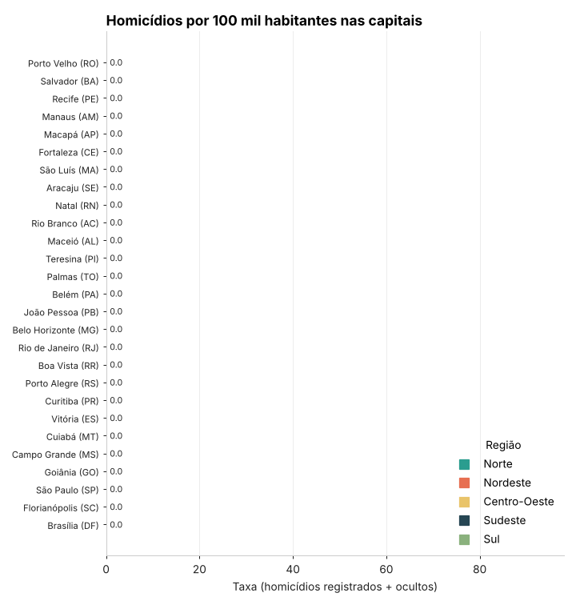
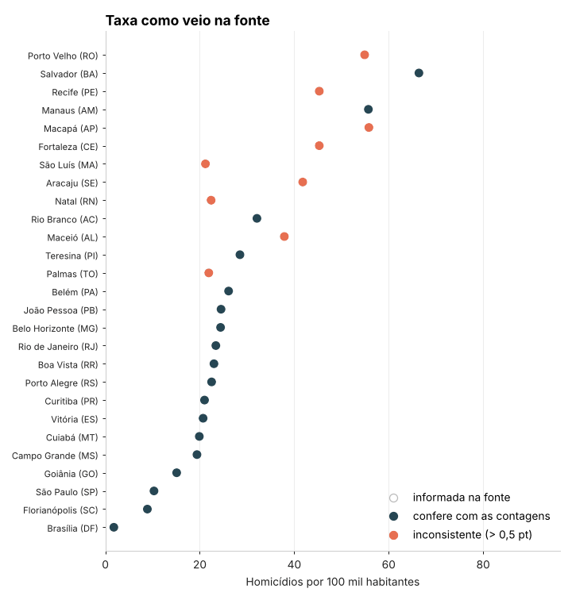
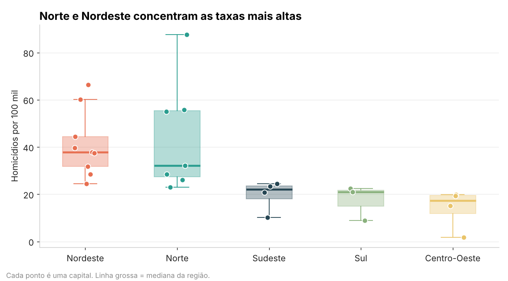
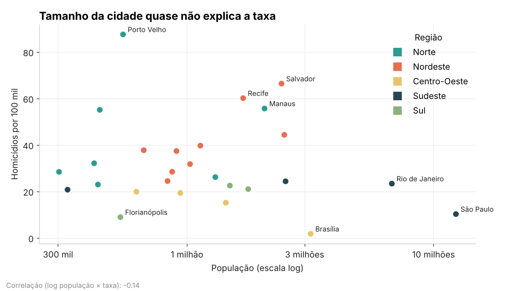
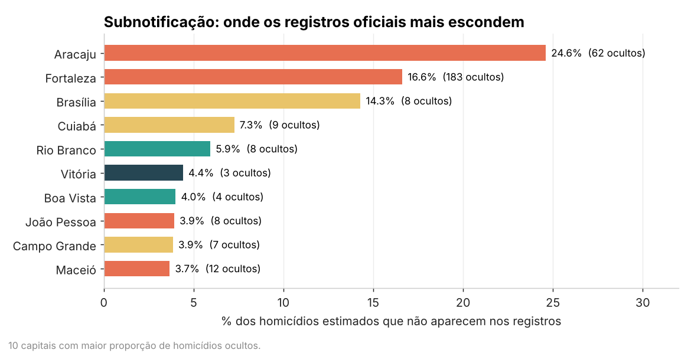
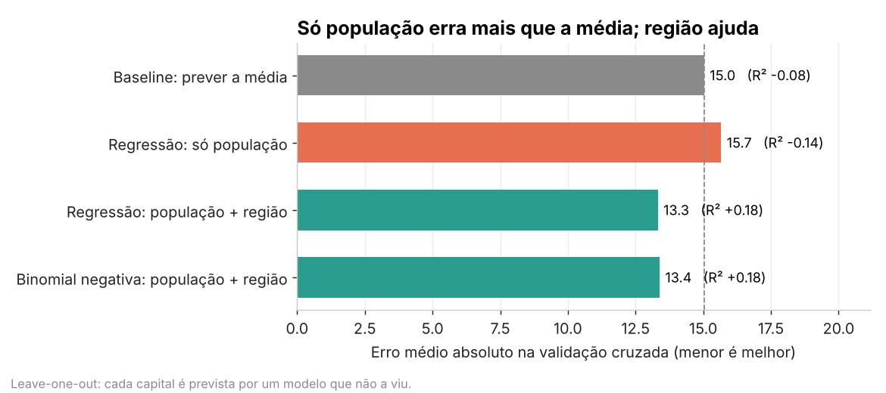
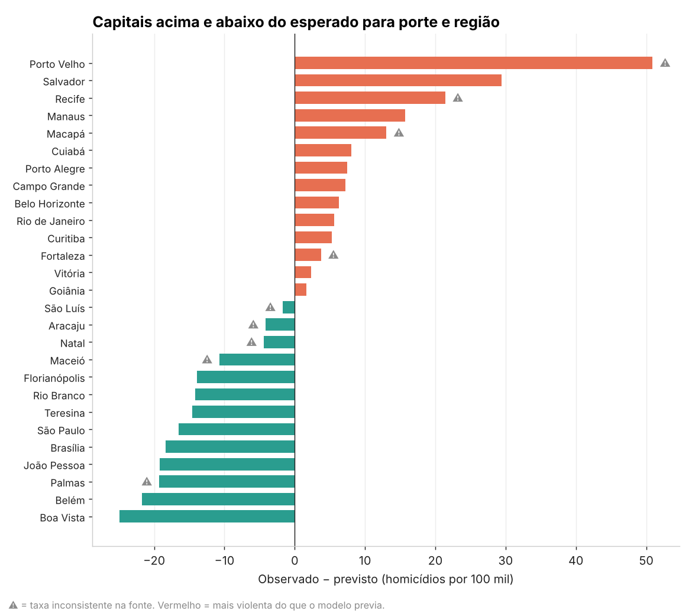

<h1 align="center">PredictiveCrimeAnalysis</h1>

<p align="center">
  Análise exploratória e preditiva da <b>taxa de homicídios nas 27 capitais brasileiras</b>,<br>
  incluindo os homicídios ocultos que não aparecem nos registros oficiais.
</p>

<p align="center">
  
  
  
  
  
</p>

<p align="center">
  
</p>

---

## Sumário

- [Principais achados](#principais-achados)
- [1. Os dados tinham erros](#1-os-dados-tinham-erros)
- [2. Exploração](#2-exploração)
- [3. Modelagem](#3-modelagem)
- [Como rodar](#como-rodar)
- [Estrutura do projeto](#estrutura-do-projeto)
- [Dicionário de dados](#dicionário-de-dados)
- [Próximos passos](#próximos-passos)
- [Uso responsável](#uso-responsável)

## Principais achados

| | Achado |
|:---:|---|
| ⚠️ | **9 das 27 capitais** têm taxa informada na fonte que não bate com homicídios ÷ população. |
| 🗺️ | **Região é o fator mais forte:** as 7 capitais do quartil de maior risco são todas do Norte ou Nordeste. |
| 📉 | **Só população não prevê nada:** erra mais do que simplesmente chutar a média. |
| 🔍 | **Subnotificação desigual:** em Aracaju, 1 em cada 4 homicídios estimados não está nos registros. |

## 1. Os dados tinham erros

Antes de qualquer modelo, o pipeline recalcula a taxa a partir das contagens. Em Porto Velho a fonte informa **54,9**, mas as contagens dão **87,6**. São Luís, Natal e Recife também mudam mais de 14 pontos.

<p align="center">
  
</p>

Nada é corrigido em silêncio: a taxa original fica no CSV ao lado da recalculada, e cada divergência vai para [`reports/validacao_dados.md`](reports/validacao_dados.md). Brasília (48 homicídios, taxa 1,8) também está sinalizada como suspeita.

## 2. Exploração

<table>
  <tr>
    <td width="50%"></td>
    <td width="50%"></td>
  </tr>
  <tr>
    <td>A mediana do Nordeste (37,7) é mais que o dobro da do Centro-Oeste (17,3); Sul e Sudeste ficam perto de 21–22.</td>
    <td>Cidades grandes não são necessariamente mais violentas: São Paulo tem uma das menores taxas.</td>
  </tr>
</table>

<p align="center">
  
</p>

Em Aracaju e Fortaleza, olhar só os registros oficiais subestima muito a violência. Por isso as análises usam sempre os homicídios **estimados** (registrados + ocultos).

Notebook completo: [`notebooks/01_analise_exploratoria.ipynb`](notebooks/01_analise_exploratoria.ipynb)

## 3. Modelagem

Com só 27 capitais, cada modelo é avaliado por **validação cruzada leave-one-out**: cada cidade é prevista por um modelo que nunca a viu. Todo modelo precisa vencer o baseline de "prever a média".

<p align="center">
  
</p>

O melhor modelo (binomial negativa com população + região) explica cerca de 18% da variação fora da amostra. Capitais do Norte têm **≈3×** a taxa do Centro-Oeste para a mesma população.

A parte mais útil para gestão pública são os **resíduos**: quais capitais estão muito acima ou abaixo do esperado para seu porte e região.

<p align="center">
  
</p>

Os maiores desvios para cima (Porto Velho, Recife) coincidem com taxas inconsistentes na fonte: **corrigir os dados deve render mais do que trocar de algoritmo.**

Notebook completo: [`notebooks/02_modelagem.ipynb`](notebooks/02_modelagem.ipynb)

## Como rodar

```bash
git clone https://github.com/rogeriocerqueira/PredictiveCrimeAnalysis.git
cd PredictiveCrimeAnalysis

python -m venv .venv && source .venv/bin/activate   # Windows: .venv\Scripts\activate
pip install -e ".[dev]"

python -m crime_analysis process   # valida data/raw e gera data/processed + relatório
python -m crime_analysis models    # compara modelos por validação cruzada
python -m crime_analysis figures   # regenera os gráficos e GIFs deste README
pytest                             # roda os testes
```

## Estrutura do projeto

```
├── data/
│   ├── raw/                  # dados originais (não editar à mão)
│   └── processed/            # gerado por `process`
├── docs/img/                 # gerado por `figures`
├── notebooks/
│   ├── 01_analise_exploratoria.ipynb
│   └── 02_modelagem.ipynb
├── reports/
│   └── validacao_dados.md    # gerado por `process`
├── src/crime_analysis/
│   ├── config.py             # caminhos e constantes
│   ├── data.py               # carga, validação e limpeza
│   ├── model.py              # modelos + validação cruzada
│   ├── figures.py            # gráficos do README
│   └── __main__.py           # CLI
├── tests/
├── SUGESTOES.md
└── pyproject.toml
```

## Dicionário de dados

<details>
<summary><code>data/processed/processed_homicidios_cleaned.csv</code></summary>

| Coluna | Descrição |
|---|---|
| `municipio`, `uf`, `regiao` | Identificação (regiões: N, NE, CO, SE, S) |
| `populacao` | População usada na fonte |
| `homicidios_registrados` | Homicídios registrados oficialmente (A) |
| `homicidios_ocultos` | Mortes violentas de causa indeterminada estimadas como homicídio (B) |
| `homicidios_estimados` | A + B |
| `taxa_informada_100k` | Taxa como veio na fonte (pode estar errada) |
| `taxa_calculada_100k` | `homicidios_estimados ÷ populacao × 100.000`; **usada nas análises** |
| `taxa_inconsistente` | `True` se informada e calculada diferem mais de 0,5 ponto |
| `pct_ocultos` | % de homicídios ocultos sobre o total estimado |
| `log_populacao` | Logaritmo natural da população |

</details>

## Próximos passos

- [ ] Conferir na fonte as 9 taxas inconsistentes e o registro de Brasília
- [ ] Ampliar para vários anos (Atlas da Violência / SIM-DATASUS)
- [ ] Incluir variáveis socioeconômicas (IBGE, PNUD), de segurança (FBSP) e de clima (INMET)
- [ ] Mapa coroplético das capitais
- [ ] CI com GitHub Actions

Detalhes e fontes em [SUGESTOES.md](SUGESTOES.md).

## Uso responsável

Os resultados são associações, não causas. Modelos de "crime preditivo" podem reforçar vieses quando usados para direcionar vigilância a pessoas ou bairros. Este projeto trabalha no nível de município e foi pensado para orientar políticas de prevenção, não policiamento direcionado.
